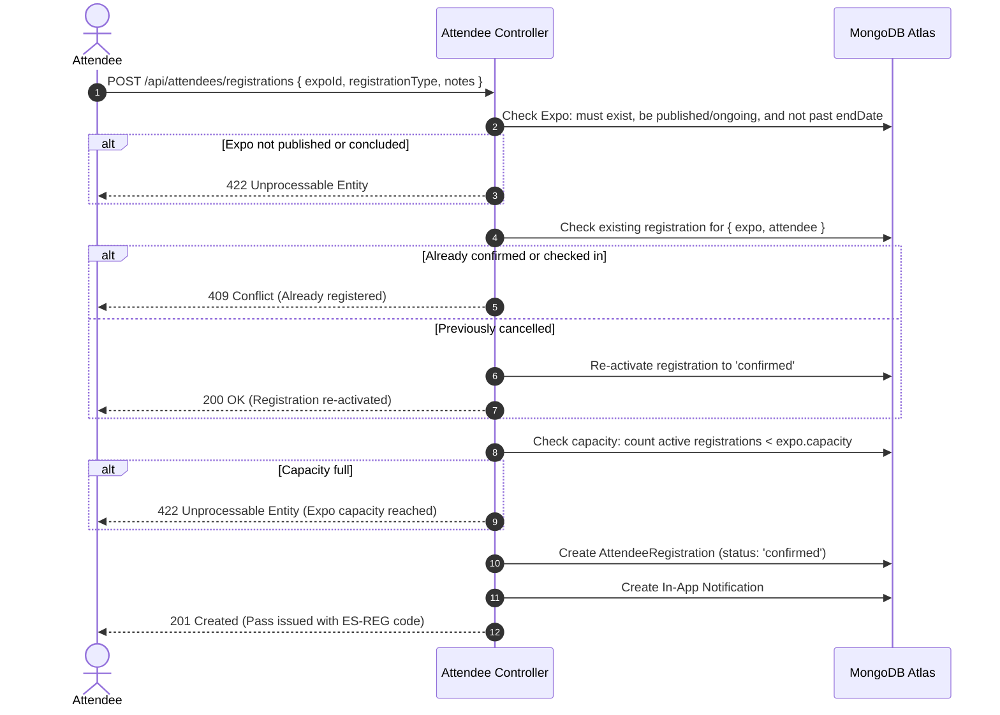

# EventSphere Management — Attendee Interface & Expo Registration

**Module:** Task 10 — Attendee Interface & Expo Registration  
**Status:** ✅ Complete  
**Date:** 2026-11-12

---

## 1. Overview

The Attendee Interface & Expo Registration module provides visitors and attendees with an end-to-end event discovery, registration, and pass management experience. Attendees can search through published trade shows, apply filters by category, location, and date, inspect comprehensive event profiles and schedules, and register for event passes with real-time capacity and duplicate prevention controls. Attendees can manage their passes on a dedicated passes portal, view event programs, or cancel registrations if plans change.

All operations strictly enforce role-based access control (RBAC), multi-tenant ownership isolation, database-level unique constraints, and safe cancellation.

---

## 2. Attendee Registration Data Model

### Mongoose Model: `AttendeeRegistration` (`attendeeregistrations`)
- `expo`: ObjectId ref `Expo` (required, immutable reference).
- `attendee`: ObjectId ref `User` (required, immutable reference).
- `registrationNumber`: Unique alphanumeric registration identifier (e.g. `ES-REG-M8K2PQ-9X4A`, unique indexed).
- `registrationType`: String enum `['standard', 'vip', 'student', 'press']` (defaults to `'standard'`).
- `status`: String enum `['confirmed', 'checked_in', 'cancelled']` (defaults to `'confirmed'`).
- `notes`: Optional string for attendee dietary, accessibility, or seating requests.
- `timestamps`: Automatic `createdAt` and `updatedAt`.

### Database Constraints:
- `{ registrationNumber: 1 }` (unique: true) — Ensures every pass code is globally unique across the platform.
- `{ expo: 1, attendee: 1 }` (unique: true) — Enforces at the database engine level that an attendee can only hold one registration record per expo.

---

## 3. Registration Workflow & Validation Rules

1. **Expo Eligibility**: Only expos with `status: 'published'` or `status: 'ongoing'` accept attendee registrations. Draft and cancelled expos return `422 Unprocessable Entity`.
2. **Timeline Check**: Expos that have already concluded (`endDate < now`) reject new registrations.
3. **Duplicate Prevention**: The database unique compound index `{ expo: 1, attendee: 1 }` and controller check reject duplicate registrations with `409 Conflict`. If an attendee previously cancelled, re-registering re-activates the pass safely.
4. **Capacity Enforcement**: If `expo.capacity > 0`, active confirmed registrations are tallied; requests exceeding capacity are blocked with `422 Unprocessable Entity`.
5. **Pass Number Generation**: Alphanumeric format `ES-REG-[TIMESTAMP]-[RANDOM]` guaranteed unique across the platform.

---

## 4. REST API Endpoints

| Method | Endpoint | Access Control | Description |
|---|---|---|---|
| `GET` | `/api/attendees/dashboard` | Attendee / Admin | Aggregated metrics (total registrations, upcoming, past, confirmed, featured expos). |
| `GET` | `/api/attendees/expos` | Public / Attendee | Search and filter published expos with category, location, date, and sort options. |
| `GET` | `/api/attendees/registrations` | Attendee / Admin | Lists logged-in attendee's registrations with populated expo information. |
| `POST` | `/api/attendees/registrations` | Attendee / Admin | Registers attendee for an expo with duplicate, capacity, and date validation. |
| `GET` | `/api/attendees/registrations/:id` | Owner Attendee / Admin | Single registration details with strict tenant ownership check (403 for other attendees). |
| `PATCH` | `/api/attendees/registrations/:id/cancel` | Owner Attendee / Admin | Cancels an active registration with ownership guard. |

---

## 5. Frontend User Experience

1. **`AttendeeDashboard.jsx` (`/attendee-dashboard`)**:
   - Welcome banner with attendee initials, quick navigation shortcuts.
   - Metrics ribbon showing Total Registrations, Upcoming Events, Confirmed Active, and Past Events.
   - Real-time stream of attendee's passes with direct links to schedules and details.
   - Featured upcoming trade shows open for registration.

2. **`BrowseExposPage.jsx` (`/attendee-browse`)**:
   - Universal expo discovery interface for attendees and visitors.
   - Multi-field filter card: search by keywords, category dropdown, city/venue filter, and date/title sorting.
   - Dynamic expo cards showing dates, location, capacity, and registration status pills (`✓ Registered` vs `Open for Reg`).
   - One-click registration modal dialog with pass type selector (`standard`, `vip`, `student`, `press`) and optional notes.
   - Built-in pagination.

3. **`MyRegistrationsPage.jsx` (`/attendee-registrations`)**:
   - Professional ticket-stub visual presentation showing unique pass reference code, pass type, status badge, dates, and venue.
   - Direct buttons for **View Schedule**, **Expo Details**, and **Cancel Pass** (with confirmation dialog).
   - Search input and status filtering (`All`, `Confirmed`, `Cancelled`).

4. **Integration with `ExpoDetailPage.jsx`**:
   - Integrated CTA buttons: If visitor/attendee views an expo detail page, they see `🎟️ Register Attendee Pass` and `📅 View Event Schedule`.
