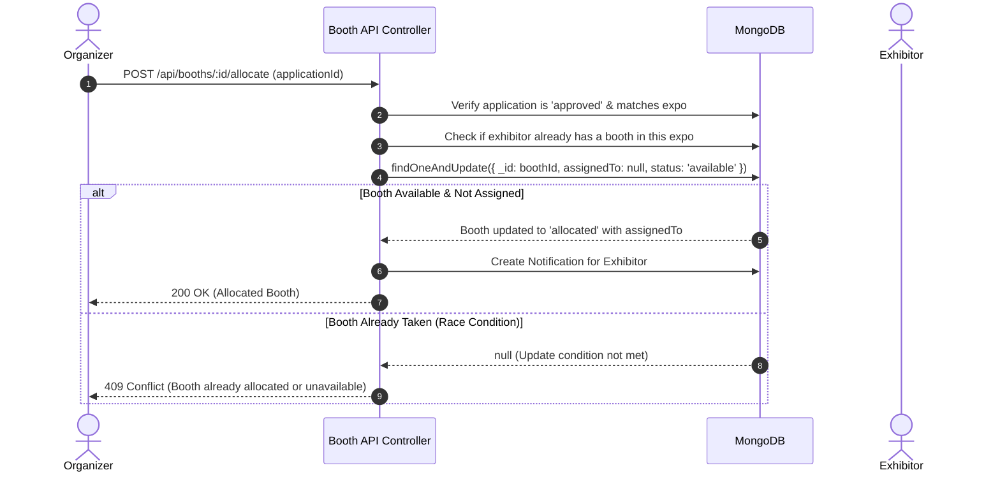

# EventSphere Management — Booth & Floor-Plan Management

**Module:** Task 08 — Booth & Floor-Plan Management  
**Status:** ✅ Complete  
**Date:** 2026-11-11

---

## 1. Overview

The Booth & Floor-Plan Management module provides organizers and exhibitors with end-to-end control and visibility over expo space allocation. Organizers can configure physical zones, establish booth inventories, set dimensions and pricing, and assign booths to approved exhibitors with strict concurrency and double-booking protections. Exhibitors can review their allocated booths and explore an interactive visual floor plan highlighting their space.

All operations enforce role-based access control (RBAC), multi-tenant expo ownership, safe deletion, and atomic assignment guarantees.

---

## 2. Booth Data Model

### Mongoose Model: `Booth` (`booths`)
- `boothNumber`: Unique alphanumeric identifier within the expo (e.g. "A-101", "B-205", required).
- `expo`: Reference to parent `Expo` (required, immutable ObjectId).
- `dimensions`: Subdocument `{ width: Number, length: Number, unit: 'meters' | 'feet' }` (defaults to 3x3 meters).
- `price`: Number representing booth rental price in USD (min 0, default 0).
- `status`: String enum `['available', 'reserved', 'allocated', 'occupied', 'maintenance']` (defaults to `'available'`).
- `assignedTo`: Reference to `User` (the exhibitor user assigned to this booth, nullable).
- `application`: Reference to `ExhibitorApplication` (the approved application associated with this booth, nullable).
- `zone`: String representing floor section or hall (e.g. "Main Hall", "Startup Pavilion", default "General").
- `type`: String enum `['standard', 'corner', 'island', 'premium']` (default `'standard'`).
- `notes`: Optional organizer internal remarks.

### Database Indexes & Integrity Constraints:
1. **Compound Unique Index on Booth Numbers**:
   `{ expo: 1, boothNumber: 1 }` with `{ unique: true }` — Guarantees no duplicate booth numbers exist within the same expo.
2. **Compound Partial Unique Index on Assigned Exhibitors**:
   `{ expo: 1, assignedTo: 1 }` with `{ unique: true, partialFilterExpression: { assignedTo: { $type: 'objectId' } } }` — Ensures at the database engine level that no exhibitor can receive more than one booth assignment in the same expo, while allowing multiple unassigned booths (`assignedTo: null`).

---

## 3. REST API Endpoints

### A. Expo Booth Inventory & Floor Plan
- **`GET /api/expos/:expoId/booths`**
  - **Access:** Public for published/ongoing expos; Organizer (owner) / Admin for all statuses.
  - **Query Params:** `zone`, `status`, `type`, `search`.
  - **Returns:**
    - `booths`: Array of populated booth records.
    - `stats`: Real-time aggregated inventory metrics `{ total, available, allocated, reserved, occupied, maintenance }`.
    - `zones`: Booths grouped by zone key for visual floor-plan rendering.

- **`POST /api/expos/:expoId/booths`**
  - **Access:** Organizer (must own expo) or Admin.
  - **Payload:** `{ boothNumber, dimensions, price, zone, type, notes }`.
  - **Behavior:** Validates fields, checks for duplicate booth numbers (409 Conflict), and creates booth with `status: 'available'`.

### B. Booth Operations
- **`GET /api/booths/:id`**
  - **Access:** Authenticated users.
  - **Returns:** Detailed booth record with populated `expo`, `assignedTo`, and `application`.

- **`PATCH /api/booths/:id`**
  - **Access:** Organizer (owner of booth's expo) or Admin.
  - **Payload:** Editable fields `{ boothNumber, dimensions, price, zone, type, notes, status }`.
  - **Protections:** Rejects booth number collisions and prevents manual assignment tampering.

- **`DELETE /api/booths/:id`**
  - **Access:** Organizer (owner of booth's expo) or Admin.
  - **Safe Deletion Guard:** Returns **`422 Unprocessable Entity`** if the booth has an active assignment (`assignedTo != null` or `status === 'allocated'`). Booths must be unallocated before deletion.

### C. Booth Allocation & Assignment Workflow
- **`POST /api/booths/:id/allocate`**
  - **Access:** Organizer (owner of booth's expo) or Admin.
  - **Payload:** `{ applicationId: ObjectId }`.
  - **Validation & Guards:**
    1. Validates that the application exists and has `status === 'approved'`.
    2. Validates that the application belongs to the same expo as the booth.
    3. Checks if the exhibitor already has a booth allocated in this expo (returns 409 Conflict).
    4. **Atomic Concurrency Lock:** Uses `Booth.findOneAndUpdate` with filter `{ _id: boothId, $or: [{ status: 'available' }, { status: 'reserved' }], assignedTo: null }` to guarantee no double-booking under concurrent requests.
    5. Dispatches an in-app `Notification` to the exhibitor with booth details.

- **`POST /api/booths/:id/unallocate`**
  - **Access:** Organizer (owner of booth's expo) or Admin.
  - **Behavior:** Atomically releases the booth back to `{ status: 'available', assignedTo: null, application: null }`.

### D. Exhibitor Space View
- **`GET /api/exhibitors/my-booths`**
  - **Access:** Authenticated Exhibitor (`role: 'exhibitor'`).
  - **Returns:** Array of all booths allocated to `req.user._id`, with populated expo details and application data.

---

## 4. Concurrency & Security Architecture

---

## 5. Frontend Architecture

### 1. `OrganizerBoothPage.jsx` (`/organizer-booths`)
- **Metrics Strip**: Displays Total Inventory, Available Spaces, Allocated Count, Reserved Count, and Dynamic Occupancy Rate bar.
- **Expo Switcher**: Allows organizers managing multiple expos to seamlessly switch between floor plans.
- **Dual View Modes**:
  - **🗺️ Visual Floor Plan**: Renders responsive CSS grid grouped by zones (Main Hall, Innovation Alley, etc.). Each tile is color-coded by status with booth dimensions, type tag, and assigned company name.
  - **📋 Inventory Table**: Compact tabular view with sorting, search filtering, and quick action buttons.
- **Action Modals**:
  - **Create / Edit Booth Modal**: Validates booth numbers, dimensions, and pricing.
  - **Allocation Modal**: Lists only approved applications for the expo with requested booth sizes and allows one-click assignment.

### 2. `ExhibitorBoothView.jsx` (`/exhibitor-booths`)
- **My Booth Cards**: Displays cards for all allocated spaces across expos with dimensions, calculated total area ($m^2$), zone, and booth status.
- **Interactive Floor Plan**: Renders the complete expo floor map with the exhibitor's assigned booth highlighted in luminous blue with a `YOU` badge.
- **Empty State**: Guided onboarding directing unallocated exhibitors to browse expos or track submitted applications.

---

## 6. Verification & Test Suite

The automated test suite `server/test/booth.test.js` covers **22 distinct test scenarios**:
- Booth creation and required field validation.
- Duplicate booth number prevention (409 Conflict).
- Multi-tenant expo ownership isolation (403 Forbidden for cross-organizer access).
- Floor-plan grouping and zone filtering.
- Allocation validation: blocks pending applications (422), blocks cross-expo applications (422).
- Allocation success: sets status, binds exhibitor, and creates notifications.
- Concurrency guards: prevents double-booking and blocks duplicate allocations per exhibitor.
- Safe deletion: blocks deletion of allocated booths (422); permits deletion of unallocated booths.
- Exhibitor assigned booth retrieval (`/my-booths`).
- Unallocation releasing space back to `available`.

All **162 tests** across the entire 7-suite regression suite pass with zero failures.
