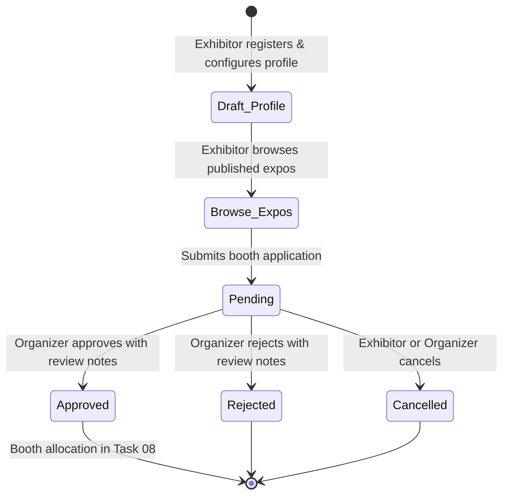

# EventSphere Management — Exhibitor Portal & Applications

**Module:** Task 07 — Exhibitor Portal & Applications  
**Status:** ✅ Complete  
**Date:** 2026-11-11

---

## 1. Overview

The Exhibitor Portal & Applications module empowers company exhibitors to establish corporate exhibition profiles, explore published and ongoing trade show opportunities, request booth footprints, and track their participation status. Concurrently, it equips expo organizers with application evaluation workflows to approve or reject exhibitor applications with structured feedback.

All capabilities enforce role-based access control (RBAC), tenant isolation, strict IDOR prevention, and duplicate submission protections.

---

## 2. Exhibitor Profile Management

Exhibitor companies configure corporate information before applying to events.

### Mongoose Model: `ExhibitorProfile` (`exhibitorprofiles`)
- `user`: Associated `User` ObjectId (unique, immutable reference).
- `companyName`: Name of the exhibitor (required, 2–200 characters).
- `companyDescription`: Detailed summary of products and services (required, max 3000 chars).
- `industry`: Business sector classification (required, e.g. Technology, Robotics & AI).
- `companyWebsite`: URL to company portal (optional).
- `logoUrl`: Direct URL to company logo (optional).
- `contactPerson`: Representative details (`name`, `email`, `phone`).
- `products`: Product and service catalog subdocuments.
- `documents`: Brochure and credential subdocuments.

### Validation & Security:
- **One profile per user**: Enforced by a unique compound database index on `{ user: 1 }`.
- **Identity isolation**: The authenticated `req.user._id` is permanently assigned; attempts to modify profile ownership via request bodies are stripped.

---

## 3. Exhibitor Dashboard

A specialized operational overview for exhibitors rendering:
- **Corporate Header**: Company badge, logo, industry tag, and navigation shortcuts.
- **Profile Completion Meter**: Calculated dynamically based on filled corporate and contact attributes.
- **Metric Counters**: Total submitted, pending review, approved, and rejected applications.
- **Recent Applications**: Inbound status stream with direct link to details.
- **Confirmed Expos**: Real-time listing of approved upcoming events.

All metrics are aggregated from real MongoDB queries (`Promise.all`), avoiding any hardcoded figures.

---

## 4. Application Workflow & Lifecycle

### Application Statuses:
- `pending`: Newly submitted application awaiting organizer evaluation.
- `approved`: Formally accepted by the organizer. Ready for booth inventory allocation (Task 08).
- `rejected`: Declined by the organizer with mandatory or optional review notes.
- `cancelled`: Withdrawn or cancelled.

### Duplicate Application Prevention:
- Database level: Compound unique index on `{ expo: 1, exhibitor: 1 }`.
- Application level: Explicit conflict validation in `POST /api/exhibitors/applications` returning `409 Conflict`.

---

## 5. Organizer Application Review

Organizers evaluate incoming exhibitor requests exclusively for expos they own.

### Capabilities:
- View comprehensive company details, industry classification, and contact representatives.
- Inspect booth requirements (size: `small`, `medium`, `large`, `custom`, floor zone preferences, electrical specifications).
- Approve or reject applications with review notes.
- In-app notification delivery to the applicant upon decision.

### Tenant Isolation:
- An organizer attempting to view or review an application for an expo owned by another organizer receives an immediate `403 Forbidden` response.

---

## 6. Notifications Integration

Leverages the unified `Notification` model to generate real-time in-app alerts:
- **Upon Application Submission**: Organizer receives notification: `"New Exhibitor Application"` for their expo.
- **Upon Approval**: Exhibitor receives notification: `"🎉 Application Approved!"`.
- **Upon Rejection**: Exhibitor receives notification: `"❌ Application Not Approved"`.

---

## 7. API Endpoints Reference

### Exhibitor Portal Endpoints (`/api/exhibitors`)

| Method | Endpoint | Auth | Role | Description |
|---|---|---|---|---|
| `GET` | `/api/exhibitors/me` | Bearer JWT | `exhibitor` | Retrieve own company profile |
| `POST` | `/api/exhibitors/profile` | Bearer JWT | `exhibitor` | Create corporate profile |
| `PUT` | `/api/exhibitors/profile` | Bearer JWT | `exhibitor` | Update corporate profile |
| `GET` | `/api/exhibitors/dashboard` | Bearer JWT | `exhibitor` | Aggregated dashboard metrics |
| `GET` | `/api/exhibitors/expos` | Bearer JWT | `exhibitor` | Browse published/ongoing expos |
| `POST` | `/api/exhibitors/applications` | Bearer JWT | `exhibitor` | Submit expo booth application |
| `GET` | `/api/exhibitors/applications` | Bearer JWT | `exhibitor` | List own submitted applications |
| `GET` | `/api/exhibitors/applications/:id` | Bearer JWT | `exhibitor` | View application record detail |

### Organizer Review Endpoints (`/api/organizer`)

| Method | Endpoint | Auth | Role | Description |
|---|---|---|---|---|
| `GET` | `/api/organizer/applications` | Bearer JWT | `organizer`, `admin` | List applications for own expos |
| `GET` | `/api/organizer/applications/:id` | Bearer JWT | `organizer`, `admin` | View applicant details |
| `PATCH` | `/api/organizer/applications/:id/status` | Bearer JWT | `organizer`, `admin` | Approve or reject application |

---

## 8. Frontend Pages

1. **Exhibitor Dashboard** (`/exhibitor-dashboard`): Profile completion meter, stats cards, application stream, confirmed expos.
2. **Company Profile** (`/exhibitor-profile`): Corporate information, logo preview, contact personnel.
3. **Browse Expos** (`/exhibitor-expos`): Discover published expos, filter by category/keyword, view applied status.
4. **Apply for Booth** (`/exhibitor-apply`): Footprint selection, special requirements, prerequisite validation.
5. **My Applications** (`/exhibitor-applications`): Status tracking, search, detail modal with feedback notes.
6. **Organizer Applications Review** (`/organizer-applications`): Inbound evaluation queue, credentials inspection, approve/reject controls.

---

## 9. Known Limitations & Future Scoping

- **Booth Number Assignment**: Allocation of physical booth inventory numbers occurs in Task 08 (Booth & Floor-Plan Management).
- **Payment Processing**: Booth sponsorship fees and invoices are handled in future payment integration.
- **Document Binary Upload**: Document attachment currently leverages URL references; binary multipart handling can be bound to cloud storage in Task 14.
